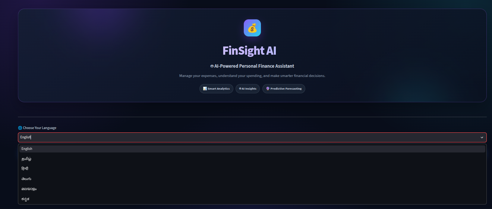
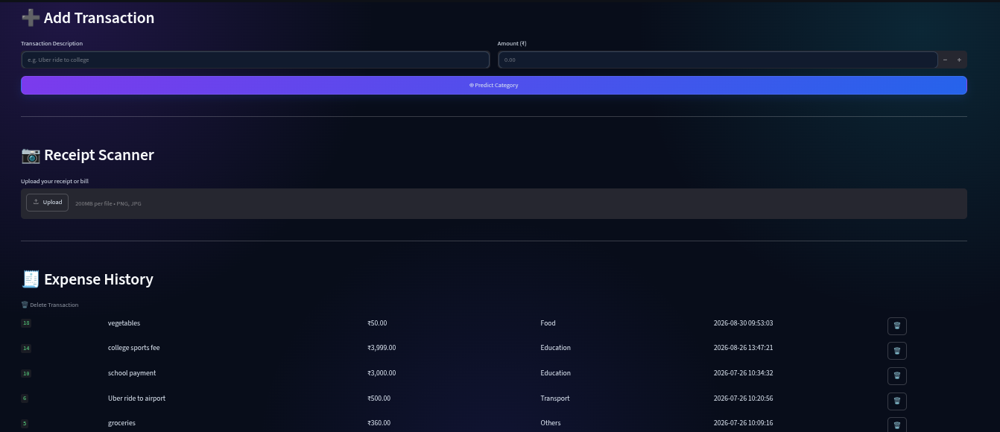
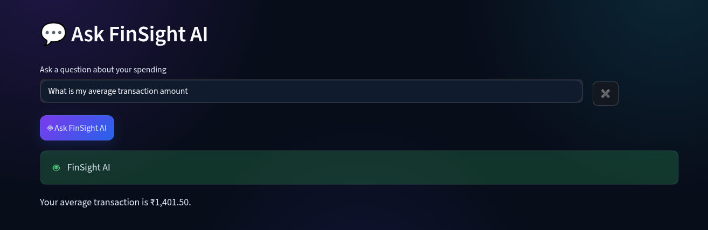
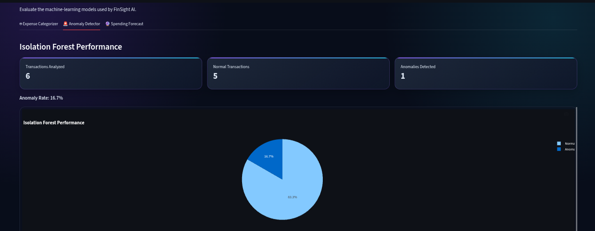
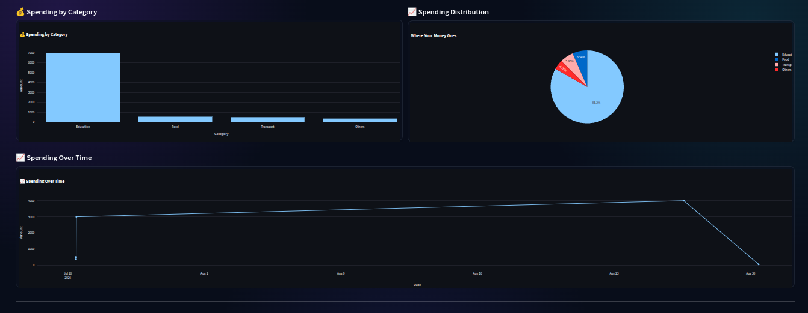

# FinSight AI — Smart Expense Tracker & Financial Analytics

A Python-based personal finance application combining data analytics, machine learning, anomaly detection, and spending forecasts.
🚀 **Live Demo:** [Try FinSight AI](https://finsight-ai-wch4jehec78exkdzl6nahp.streamlit.app/)
## Overview

FinSight AI helps users record expenses, monitor budgets, understand spending patterns, and identify transactions that may deserve review through an interactive Streamlit dashboard.

## Key Features

- Expense management: add, view, edit, and delete transactions.
- Financial dashboard: spending totals, category comparisons, and monthly analysis.
- Budget intelligence: review expenses against budget limits.
- ML-based expense categorization using text features and a trained classifier.
- Anomaly detection using Isolation Forest to flag statistically unusual amounts.
- Statistical spending forecasts using Linear Regression and lagged spending features.
- LSTM forecasting pipeline for sequential spending data.
- Receipt text extraction using OCR.
- Financial insights, supported Finance Q&A, and spending recommendations.
- Multilingual interface.
- Model evaluation information.

## Data Science and Machine Learning

### Expense Categorization
Transaction descriptions are transformed into numerical text features, such as TF-IDF, for machine learning classification. The goal is to reduce manual categorization and organize transactions for analysis.

### Anomaly Detection
Isolation Forest identifies transaction amounts that appear unusual relative to the data. These flags help users review transactions; they are not proof of fraud.

### Statistical Forecasting
A Linear Regression approach uses lagged monthly spending and a rolling average to estimate future spending. Forecast accuracy depends on data quality and sufficient history.

### LSTM Forecasting
The project includes an LSTM forecasting pipeline intended to learn sequential spending patterns. Its production readiness and performance must be validated before claiming that it outperforms the statistical baseline.

### Financial Analytics
Pandas is used for data cleaning, aggregation, category summaries, and monthly spending analysis. Supported Finance Q&A responses use programmed logic and should not be confused with a general-purpose generative AI model.

## Technology Stack

- Python
- Streamlit
- Pandas and NumPy
- Scikit-learn
- SQLite
- Linear Regression and an LSTM pipeline
- Tesseract OCR and Pillow

## Application Workflow

1. Enter expenses or extract text from receipts.
2. Store and retrieve transactions using SQLite.
3. Prepare and analyze transaction data.
4. Categorize expenses and calculate financial metrics.
5. Review budgets and statistically unusual transactions.
6. Explore insights and available spending forecasts.

## Project Structure

```text
FinSight-AI/
├── modules/
├── models/
├── streamlit_app.py
├── app.py
├── train_model.py
├── requirements.txt
└── README.md
```

## Run Locally

Prerequisites: Python, Git, and the dependencies in `requirements.txt`. Tesseract OCR is required for receipt OCR.

```bash
git clone https://github.com/Dhanusri-analyst/FinSight-AI.git
cd FinSight-AI

python -m venv venv
source venv/bin/activate

pip install -r requirements.txt
streamlit run streamlit_app.py
```

Open the local URL printed in the terminal.

## Evaluation and Limitations

- Model quality should be reported using held-out data and suitable metrics.
- Forecasts should be compared with a baseline using metrics such as MAE and RMSE.
- Anomaly detection can flag legitimate purchases and can miss unusual transactions.
- Forecasting reliability depends on sufficient historical data.
- OCR output may require manual correction.
- Financial insights are informational, not professional financial advice.

Do not interpret results from synthetic demonstration data as proof of real-world model performance.

## Future Improvements

- Add screenshots and a demo of the running application.
- Evaluate categorization with precision, recall, and F1-score on held-out data.
- Compare forecasting models using consistent baselines.
- Expand automated tests and deployment documentation.

## Author

**Dhanusri Prabhakaran**  


GitHub: [Dhanusri-analyst](https://github.com/Dhanusri-analyst)

---

FinSight AI is a portfolio project demonstrating practical application development, data analysis, and machine learning workflows.
## Application Screenshots

### FinSight AI — Application Overview


### Expense Management and Receipt Scanner


### Finance Q&A


### Machine Learning — Anomaly Detection


### Spending Analytics


